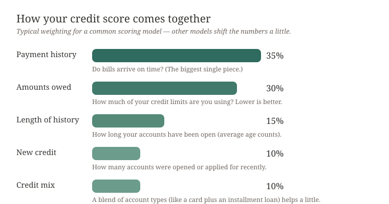

# How scores actually work

*Reading time: about 8 minutes. This is chapter 04 of [The Credit and Debt Calm Guide](index.md).*

Credit scores have a reputation for vagueness, like a teacher who grades pop quizzes in invisible ink. In fact the ingredients are unusually well known. Here's the whole thing, in one diagram:

## The report vs. the score (get this difference and everything simplifies)

- Your **credit report** is the data: every account, every limit, every balance, every late month. You get it free, chapter [01](01-pull-your-reports-safely.md) explained how.
- Your **credit score** is a formula run *on that data.*

That means a score isn't a thing you directly fix any more than a fever is. You treat the data — errors disputed ([chapter 02](02-dispute-errors-plain-letters.md)), balances and habits (this chapter) — and the number follows. Anyone who implies they can "raise your score directly" is selling weather.

## The five factors, one per paragraph

**Payment history — 35%, your biggest piece.** The formula checks whether bills arrived on time. One late payment matters much, much less than a pattern, and a couple years of on-time months soften a long-past rough patch. The practical version: automate minimums for every account (even $5 forgotten ones — those are the ones that go "late"). Old misses fall off the report in time; recent ones weigh the most.

**Amounts owed (utilization) — 30%.** The formula compares what you owe against your credit limits — as a percentage, called utilization. Lower is better; the classic guidance is to stay below about 30% of your limits, and much lower than that scores even better. Two details that genuinely matter: utilization is measured *per card* as well as across all cards combined (a card at 90% of its limit hurts even if your total is modest), and it's the balance on each card's **statement** that usually gets reported — meaning the reported number is a photo of one day each month, not what you carry every day.

**Length of history — 15%.** Older accounts are better, mostly because they demonstrate longer patterns. This is why the well-meaning advice "close the card you never use!" is, delicately, backwards for scores: a closed card stops aging, stops adding average age, and can *raise* your utilization by shrinking your total limits. Keep old no-fee accounts open; use them for one small recurring charge — a streaming subscription at a couple of dollars, say (audit those, too — the companion guide *subscription-audit-handbook* walks through finding and trimming them) — so the issuer doesn't eventually close them for inactivity.

**New credit — 10%.** Each application can produce a hard inquiry, which dents the score by a few points for about a year. Clusters of applications read as stress in the formula. The calm version: apply when you actually need something, space applications roughly months apart when you can, and don't open a card "for the discount" on a day you're also financing a car.

**Credit mix — 10%.** The formula quietly likes seeing you handle different kinds of accounts — say, a card (revolving) plus an installment loan. It's the smallest factor, and nobody should borrow money *just because* their mix lacks a species of account. If life naturally involves both, fine; nothing to optimize.

## Ranges, models, versions — a 60-second demystification

- Most common scores run **300 to 850**. There are multiple scoring model families and versions, and they weight things slightly differently, so your number varies honestly from place to place.
- No single "the score" exists; a lender sees *a* score, computed from *one* bureau's data, through *one* model. Trying to micromanage a thirty-point spread across apps will make you crazy and accomplish nothing.
- Ask any lender *which bureau and which model* they pull, and future questions melt.

## The myths worth retiring

- **"Carrying a balance builds credit."** No — paying on time builds credit. Interest you pay builds nothing but the issuer's boat fund.
- **"Checking my score hurts it."** Nothing you check yourself hurts anything.
- **"A closed account erases history."** No — a closed, paid-as-agreed account usually *stays* on your report and keeps aging for years. And closing it removes its limit from the utilization math, which can *raise* your percentage. Keep old no-fee cards open.
- **"Perfect 850 takes decades."** High 700s does everything a 850 does at a mortgage desk; nobody should chase the last points.

## What to do with this, this week

1. Read your report rows (chapter [01](01-pull-your-reports-safely.md)) and confirm utilization is what you think it is — *per card, statement balance vs. that card's actual limit*. A $300 balance on a $1,000 card is exactly the sort of quiet 30% problem this diagram predicts.
2. Automate every minimum payment, today, in every account's own portal. This alone handles most later-"how did it drop?" score surprises for most people.
3. If some balances routinely report high, set a calendar nudge for a few days before each statement to pay the balance down (or down the rest after regular purchases) so the reported *photo* is low. No rule requires you to carry a balance — only to pay at least the minimum by the due date.
4. Errors and unknown names: straight to [chapter 02](02-dispute-errors-plain-letters.md) with its letters.

Then — and this matters — go one layer down the stack: the *debt* behind the balances gets handled in [chapter 05](05-debt-payoff-order.md), which pairs the math version of payment order with a morale version, because both are real factors in whether a plan survives March.

> **A note on sources:** exact weightings shift a little between scoring model and version; the diagram shows the classic, widely-cited pattern of a common major model. When a decision hinges on one specific number, ask the lender which bureau and which model they use — you'll get a straight answer, and it's often free to ask.
